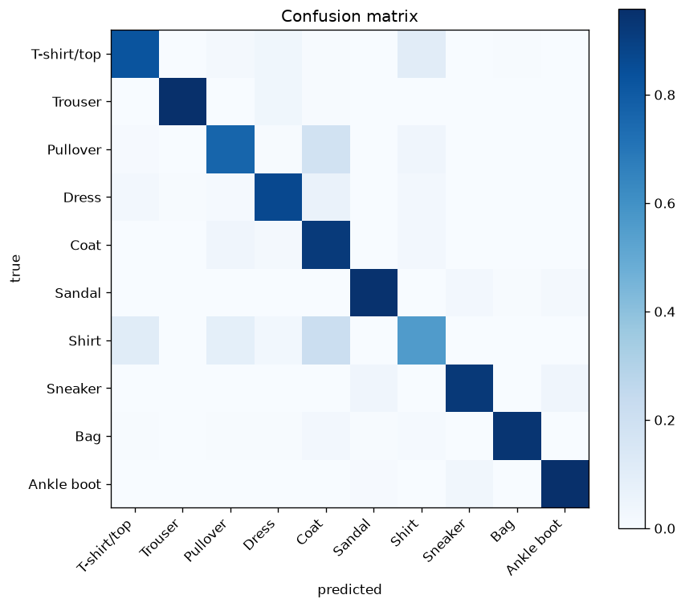
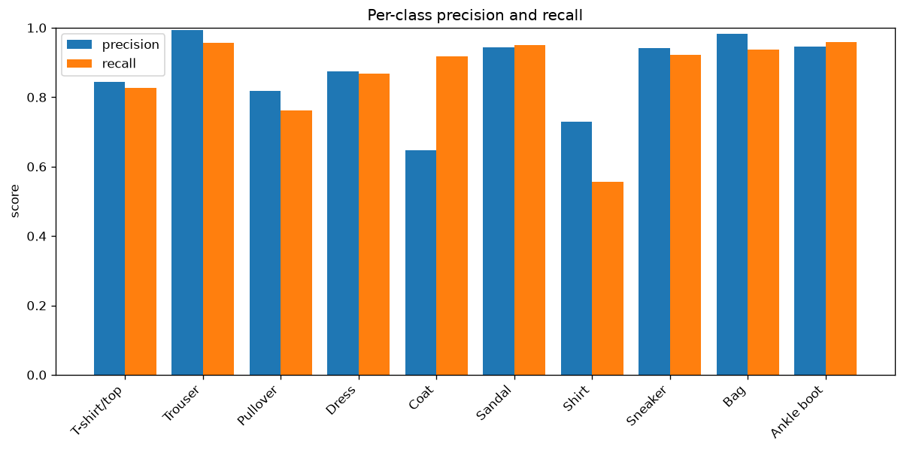

# Fashion-MNIST from scratch

This is a 10-class classifier written from scratch using NumPy and the publicly available Fashion-MNIST dataset. Each implementation written from scratch is accompanied by a set of unit tests to ensure robustness. After which, the project results, visualized via Jupyter notebook, are validated against the outputs of a PyTorch implementation.

## Goal
I wanted to practice the Machine/Deep Learning concepts I learned, that is:
- Forward Propagation
- Backpropagation
- Gradient Checking
- Holdout Validation (Dev) Set
- Mini-batch Processing
- Early Stopping
- Confusion Matrix
- Precision-Recall

Other notable features:
- Unit Tests using pytest
- matplotlib and Jupyter for visualization


## Results

|                        | from scratch (NumPy) | PyTorch  |
|------------------------|----------------------|----------|
| Test accuracy          | 86.54%               | 86.94%   |
| Epochs (early stopped) | 10                   | 11       |
| Training time (CPU)    | 5.99 sec             | 4.32 sec |

Accuracy and epochs are reproducible — every run in both notebooks is seeded.
Training time is wall-clock and varies slightly with machine load.

### Confusion Matrix


### Precision/Recall


## What the errors reveal
The bar chart reveals that **Shirts** have the **lowest recall**. Looking at the confusion matrix, we see that recall is low because **Shirts** are confused with: **T-Shirts**, **Pullover**, and **Coats**. **Coats** are the most common mistake. A lot of real **Shirts** are predicted as **Coats**.

**Coats** have **high recall**, suggesting that it catches almost all **Coats**. However, it also has **lowest precision** as it misclassifies **Pullovers** and **Shirts** as **Coats**. This aligns with the observations on the previous paragraph.

## Architecture

<!-- Subtask 7a: the network and the data convention —
     layer sizes, ReLU hidden / softmax output, mini-batch GD, samples-as-columns. -->


## Correctness

<!-- Subtask 7b: how you know the math is right —
     gradient-checking result (~1e-9) and the number of unit tests. -->


## Repository layout

<!-- Subtask 5: pre-filled from the current tree; adjust if it drifts. -->

```
src/          model, activations, losses, metrics, gradient checking
notebooks/    01 from scratch, 02 PyTorch twin (cell-for-cell mirror)
tests/        58 unit tests
results/      metrics JSON from both training runs
```


## Setup

```bash
python -m venv venv
source venv/bin/activate
pip install -r requirements.txt
```


## Running it

<!-- Subtask 6: how to run the tests, then the notebooks in order
     (select the venv as the kernel). -->

```bash
pytest
```


## Next steps

<!-- Subtask 8: two bullets. -->

-
-

<!-- Subtask 9: preview with Ctrl+Shift+V in VS Code, then commit. -->

